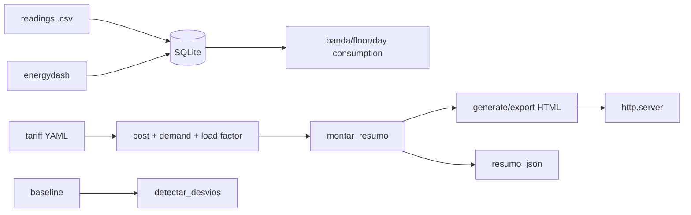

# energy-dashboard-predial

**English** · [Português (Brasil)](README.md)

[](#) [](#) [](#) [](LICENSE)

## What it is

**A building energy dashboard**: meter readings (CSV) → **SQLite**, analysed by **tariff band** (off-peak/intermediate/peak), with **period cost**, **peak demand (kW)**, **load factor**, a **baseline** and **consumption-deviation detection**. Output in **JSON**, text and **HTML** with a built-in http.server. It is an educational lab on building energy efficiency.

## Status

An educational lab, working and tested (74 tests).

## Features

- **Series** (`serie.py`): `ler_csv` → `Leitura`; `total_kwh`, `por_dia`, `media_por_horario`, `filtrar_por_andar`.
- **Persistence/queries** (`consulta.py`): SQLite load, `consumo_por_dia`, `consumo_por_andar`, `leituras_periodo`.
- **Tariffs** (`custo.py`): `Tarifa` per band (`banda`), `custo_periodo`, `demanda_kw` and `fator_de_carga` (15-minute interval).
- **Baseline** (`linha_base.py`): `PontoLinhaBase`/`LinhaBase` (expected × observed).
- **Deviations** (`desvio.py`): `detectar_desvios` with a threshold (`excede_limiar`) — flags periods off the baseline.
- **Reports** (`relatorio.py`): `gerar_html` (template), `exportar_html`, `resumo_em_texto`.
- **API/summary** (`api.py`): `montar_resumo` + `resumo_json`.
- **Server** (`servidor.py`): `criar_servidor`/`iniciar_em_thread` to serve the report.
- **CLI** (`energydash`).

## Architecture

An `energydash` package with pure layers (serie, consulta, custo, linha_base, desvio, relatorio, api) + an http.server.



## Stack

- Python ≥ 3.10
- PyYAML ≥ 6.0 (only dependency; SQLite/HTTP via stdlib)
- pytest (dev)

## Repository layout

```
energy-dashboard-predial/
├── pyproject.toml · BRIEF.md
├── src/energydash/
│   ├── serie.py · consulta.py · custo.py
│   ├── linha_base.py · desvio.py · relatorio.py
│   ├── api.py · servidor.py · cli.py
├── dados/ · templates/
├── tests/             # 74 tests
└── LICENSE            # MIT
```

## Prerequisites and installation

```bash
pip install -e .
```

## How to run

```bash
energydash --help
# subcommands defined in cli.py (the parser is the reference)
```

## Tests and quality

Real command (verified by the agent):

```bash
PYTHONPATH=src python -m pytest tests/
# 74 passed
```

## Technical decisions and trade-offs

- **SQLite via stdlib**: zero external services; analysis derivable with simple SQL.
- **Demand over a fixed interval (15 min)**: standard building metering; typical load-factor calc.
- **Baseline + deviations**: efficiency translated to expected × observed.

## Known limitations and roadmap

- CSV import only (no real-time meter integration).
- One meter/floor per reading; no consolidated multi-meter view.

## Development process

An individual project by Kelvin Oliveira, built with orchestrated AI agents and reviewed by the author.

## License and author

MIT — Copyright (c) 2026 Kelvin Rebelo de Oliveira. Author: [Kelvin Oliveira](https://github.com/KelvinOliveiraCode) · [Portfolio](https://kelvinoliveiracode.github.io/portfolio/)
