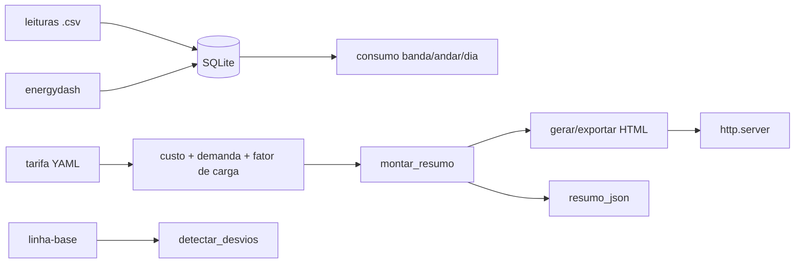

# energy-dashboard-predial

[English](README.en.md) · **Português (Brasil)**

[](#) [](#) [](#) [](LICENSE)

## O que é

**Dashboard de energia predial**: leituras de medidores (CSV) → **SQLite**, com análise por **banda tarifária** (fora/intermediária/ponta), **custo do período**, **demanda máxima (kW)**, **fator de carga**, **linha-base** e **detecção de desvios** de consumo. Saída em **JSON**, texto e **HTML** com um servidor http.server embutido. É um laboratório educacional de eficiência energética em prédios.

## Status

Laboratório educacional funcional e testado (74 testes).

## Funcionalidades

- **Séries** (`serie.py`): `ler_csv` → `Leitura`; `total_kwh`, `por_dia`, `media_por_horario`, `filtrar_por_andar`.
- **Persistência/consultas** (`consulta.py`): carga em SQLite, `consumo_por_dia`, `consumo_por_andar`, `leituras_periodo`.
- **Tarifas** (`custo.py`): `Tarifa` por bandas (`banda`), `custo_periodo`, `demanda_kw` e `fator_de_carga` (intervalo de 15 min).
- **Linha-base** (`linha_base.py`): `PontoLinhaBase`/`LinhaBase` (esperado × observado).
- **Desvios** (`desvio.py`): `detectar_desvios` com limiar (`excede_limiar`) — aponta períodos fora da linha-base.
- **Relatórios** (`relatorio.py`): `gerar_html` (template), `exportar_html`, `resumo_em_texto`.
- **API/resumo** (`api.py`): `montar_resumo` + `resumo_json`.
- **Servidor** (`servidor.py`): `criar_servidor`/`iniciar_em_thread` para servir o relatório.
- **CLI** (`energydash`).

## Arquitetura

Pacote `energydash` com camadas puras (serie, consulta, custo, linha_base, desvio, relatorio, api) + servidor http.server.



## Stack

- Python ≥ 3.10
- PyYAML ≥ 6.0 (única dependência; SQLite/HTTP via stdlib)
- pytest (dev)

## Estrutura do repositório

```
energy-dashboard-predial/
├── pyproject.toml · BRIEF.md
├── src/energydash/
│   ├── serie.py · consulta.py · custo.py
│   ├── linha_base.py · desvio.py · relatorio.py
│   ├── api.py · servidor.py · cli.py
├── dados/ · templates/
├── tests/             # 74 testes
└── LICENSE            # MIT
```

## Pré-requisitos e instalação

```bash
pip install -e .
```

## Como executar

```bash
energydash --help
# subcomando(s) definidos em cli.py (parser como referência)
```

## Testes e qualidade

Comando real (verificado pelo agente):

```bash
PYTHONPATH=src python -m pytest tests/
# 74 passed
```

## Decisões técnicas e trade-offs

- **SQLite via stdlib**: zero serviços externos; análise dedutível por SQL simples.
- **Demanda por intervalo fixo (15 min)**: padrão da medição predial; fator de carga típico.
- **Linha-base + desvios**: eficiência transladada a expectativa × observado.

## Limitações conhecidas e roadmap

- Import só de CSV (sem integrar medidores em tempo real).
- Um medidor/andar por leitura; sem medição multi-usina consolidada.

## Processo de desenvolvimento

Projeto individual de Kelvin Oliveira, construído com agentes de IA orquestrados e revisado pelo autor.

## Licença e autor

MIT — Copyright (c) 2026 Kelvin Rebelo de Oliveira. Autor: [Kelvin Oliveira](https://github.com/KelvinOliveiraCode) · [Portfólio](https://kelvinoliveiracode.github.io/portfolio/)
